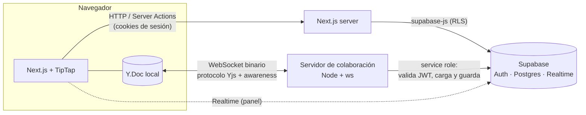

# Tinta — notas colaborativas en tiempo real

Un Google Docs ligero: varias personas editan el mismo documento a la vez, ven los cursores de las demás y todo se guarda solo.

**Stack:** Next.js 16 (App Router, Cache Components) · WebSockets (`ws` + protocolo Yjs) · Supabase (Auth, Postgres con RLS y Realtime) · TipTap 3 · Tailwind CSS 4.

## Funcionalidades

- **Edición simultánea sin conflictos.** El documento es un CRDT ([Yjs](https://yjs.dev)): las ediciones concurrentes, incluso en la misma línea, convergen al mismo resultado en todos los clientes.
- **Cursores y selecciones en vivo**, con el nombre y el color de cada persona, y **avatares de presencia** (quién está editando y quién solo lee).
- **Texto enriquecido:** títulos, negrita, cursiva, subrayado, tachado, código, enlaces, listas, listas de tareas, citas, bloques de código, separadores y deshacer/rehacer (solo tus propios cambios).
- **Título colaborativo:** el título también es un `Y.Text`, así que dos personas pueden escribirlo a la vez.
- **Permisos:** propietario, editor y lector. Se puede invitar por email o compartir un enlace de lectura o de edición.
- **Guardado automático** en Supabase, con debounce. Si se corta la conexión puedes seguir escribiendo y los cambios se envían al reconectar.
- **Panel de documentos** con búsqueda, filtros (míos / compartidos) y refresco en vivo mediante Supabase Realtime.
- **Revalidación de permisos en caliente:** si el propietario quita el acceso o cambia el rol de alguien que está conectado, su conexión se cierra en menos de 30 s.

## Arquitectura



1. **Next.js** sirve la UI, gestiona el login (Supabase Auth con cookies vía `@supabase/ssr`) y las operaciones de metadatos (crear, borrar, compartir) protegidas por RLS.
2. Al abrir un documento, el navegador conecta por WebSocket a `ws://…/<documentId>?token=<access_token>`.
3. El **servidor de colaboración** (`server/`):
   - valida el JWT de Supabase y comprueba la pertenencia al documento. Si no hay acceso, cierra con un código propio: `4401` token, `4403` acceso, `4404` no existe, `4409` permisos cambiados;
   - mantiene en memoria un `Y.Doc` por documento abierto (una *room*), reenvía cada actualización al resto de clientes y la presencia (cursores);
   - impone la identidad real en la presencia (nadie puede hacerse pasar por otro en los cursores) e ignora las escrituras de los lectores;
   - guarda el estado binario de Yjs, el título y una vista previa en Postgres (1,5 s tras el último cambio, como máximo cada 10 s) y libera la memoria cuando sale el último cliente.

### Modelo de datos (`supabase/migrations/`)

| Tabla | Contenido | Acceso de clientes |
|---|---|---|
| `profiles` | nombre, email y color del cursor (se crea al registrarse) | el propio perfil y los de tus colaboradores |
| `documents` | título, vista previa, acceso por enlace | miembros; solo el propietario cambia el acceso o borra |
| `document_members` | rol de cada usuario en cada documento | miembros leen; el propietario gestiona |
| `document_states` | estado binario Yjs (`bytea`) | **ninguno**, solo el servidor WS (service role) |

Las altas pasan por funciones RPC que validan: `create_document`, `open_document` (añade al usuario si el documento se comparte por enlace) y `add_document_member`. El servidor usa `save_document_snapshot`, que guarda de forma atómica y solo puede ejecutarlo la service role.

## Puesta en marcha

Requisitos: **Node.js 20.12 o superior** y un proyecto de [Supabase](https://supabase.com) (el plan gratuito sirve).

### 1. Base de datos

En el dashboard de Supabase abre **SQL Editor**, pega el contenido de `supabase/migrations/20261122000000_init.sql` y ejecútalo.

> Con la CLI: `npx supabase init` (no toca la carpeta `migrations`), `npx supabase link --project-ref <ref>` y `npx supabase db push`.

### 2. Autenticación

En **Authentication → URL Configuration**:

- *Site URL*: `http://localhost:3000`
- *Redirect URLs*: añade `http://localhost:3000/auth/callback`

Para probar rápido en local puedes desactivar **Confirm email** en *Authentication → Sign In / Providers → Email*. Así el registro inicia sesión directamente.

### 3. Variables de entorno

```bash
cp .env.example .env.local
```

Rellena los valores con los de **Project Settings → API Keys**: la clave publicable para `NEXT_PUBLIC_SUPABASE_PUBLISHABLE_KEY` y la clave secreta para `SUPABASE_SECRET_KEY`. Las antiguas claves `anon` y `service_role` también sirven.

### 4. Arrancar

```bash
npm install
```

```bash
npm run dev
```

Esto levanta a la vez la web en <http://localhost:3000> y el servidor de colaboración en `ws://localhost:1234`. También puedes arrancarlos por separado con `npm run dev:web` y `npm run dev:collab`.

Para verlo en acción, crea dos cuentas, abre un documento con la primera, invita a la segunda desde **Compartir** y ábrelo en otra ventana (o en una ventana de incógnito).

## Scripts

| Comando | Qué hace |
|---|---|
| `npm run dev` | web + servidor WS en modo desarrollo |
| `npm run build` / `npm start` | build y arranque de producción de la web |
| `npm run start:collab` | servidor de colaboración en producción |
| `npm test` | tests de integración del servidor WS (no necesitan Supabase) |
| `npm run lint` | ESLint |
| `npm run typecheck` | genera los tipos de rutas y ejecuta `tsc` |

Los tests (`tests/collab-server.test.ts`) conectan clientes Yjs reales al servidor y comprueban: sincronización, convergencia de ediciones concurrentes, que los lectores no pueden escribir, que la presencia no se puede suplantar, los códigos de cierre 4401/4403/4404, la revalidación de permisos (4409/4403), la persistencia y recarga, y el cierre al borrar un documento.

## Despliegue

- **Web (Next.js):** Vercel o cualquier hosting de Next. Configura las variables `NEXT_PUBLIC_*`, con `NEXT_PUBLIC_COLLAB_URL=wss://collab.tudominio.com`, y añade `https://tudominio.com/auth/callback` a las *Redirect URLs* de Supabase.
- **Servidor de colaboración:** necesita un proceso Node de larga duración con WebSockets (Railway, Render, Fly.io, un VPS…). Las funciones serverless de Vercel no sirven para esto.
  - Comando de arranque: `npm run start:collab`, que respeta la variable `PORT`.
  - Variables: `SUPABASE_URL` (o `NEXT_PUBLIC_SUPABASE_URL`), `SUPABASE_SECRET_KEY` y `COLLAB_ALLOWED_ORIGINS=https://tudominio.com`.
  - Health check: `GET /health`.
  - Ante `SIGTERM` guarda todos los documentos antes de salir; los clientes reconectan solos.

## Estructura

```
server/                     Servidor WebSocket de colaboración
  collab-server.ts          upgrade HTTP→WS, autorización, ciclo de vida de rooms, heartbeat
  room.ts                   Y.Doc + awareness + conexiones + guardado con debounce
  supabase-backend.ts       validación de JWT, permisos y persistencia en Supabase
  doc-text.ts               extrae título y vista previa del Y.Doc
src/
  proxy.ts                  refresca la sesión y protege /docs (antes "middleware")
  app/
    page.tsx                landing
    login/                  login y registro (Server Actions)
    auth/callback/          confirmación de email
    docs/                   panel de documentos (+ Supabase Realtime)
    docs/[id]/              página del editor
  components/editor/        editor colaborativo (TipTap + Yjs), barra, presencia, compartir
  lib/collab/protocol.ts    constantes compartidas cliente/servidor (códigos de cierre…)
  lib/supabase/             clientes de Supabase y tipos de la BD
supabase/migrations/        esquema, RLS y funciones
tests/                      tests de integración del servidor WS
```

## Limitaciones y siguientes pasos

- **Una instancia del servidor WS.** Cada documento vive en la memoria de un proceso. Para escalar horizontalmente hace falta enrutar por `documentId` (sticky) o sincronizar instancias con pub/sub (p. ej. Redis o `y-redis`).
- **Sin historial de versiones.** Yjs permite guardar *snapshots* para implementarlo.
- **Invitaciones solo a cuentas existentes.** Una mejora natural es enviar un email de invitación.
- El token viaja en la query string del WebSocket (es lo que soporta `y-websocket`). Caduca en 1 h y se renueva solo, pero conviene no registrar URLs completas en los logs del proxy.
- Ideas: comentarios en línea, exportar a Markdown/PDF, caché offline con `y-indexeddb` y modo oscuro manual.
